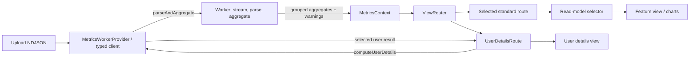

# GitHub Copilot User Level Metrics Viewer

Architecture, data ownership, and interpretation rules for the browser-only metrics viewer.
See [PRODUCT.md](../PRODUCT.md) for product direction and [README.md](../README.md) for setup and commands.

## Purpose and Supported Input

Engineering leaders and Copilot administrators upload GitHub Copilot user-level `.ndjson` exports to explore adoption and usage by user, IDE, language, feature, and model. Files stay in the browser; there is no backend.

- Each record represents one user's activity for one day. [CopilotMetrics](../src/types/metrics.ts) defines the input contract.
- Only the new LOC schema (`loc_added_sum`, `loc_deleted_sum`, `loc_suggested_*`) is supported. Records with deprecated `generated_loc_sum` / `accepted_loc_sum` fields or missing required fields are skipped.
- Broader input validation is external to the viewer. Aggregate enterprise/organization reports are not supported input.
- `public/data/vscode.json` and `public/data/jetbrains.json` provide contextual plugin metadata, not primary metrics.

## Architecture Invariants

- **Static, client-side application.** Next.js App Router, TypeScript, Tailwind CSS, Primer, and Chart.js (`react-chartjs-2`). `output: 'export'` targets GitHub Pages; no SSR or API routes.
- **Parsing and aggregation stay in a Web Worker.** The `parseAndAggregate` flow returns only compact, grouped aggregates. Raw `CopilotMetrics[]` never reaches view components or main-thread state.
- **Worker bundling is explicit.** [build-worker.mjs](../scripts/build-worker.mjs) uses esbuild to produce the self-contained `public/workers/metricsWorker.js` IIFE before `next dev` and `next build`.
- **User details are on demand.** The worker retains a compact user-detail accumulator, not raw records for the UI, and finalizes only the selected user's detail response.
- **Each aggregate has one owner.** Metric-family accumulators own creation, record consumption, and finalization. The coordinator wires them together in one raw-record loop and assembles the grouped contract without duplicate aggregation.
- **Read models are pure projections.** Selectors preserve nested references without copying, sorting, filtering, or mutation. Deterministic feature-specific scalar/date derivations are allowed; only the selected route computes its projection.

## Data Flow

1. `useFileUpload` checks extensions and requests parsing through the typed worker client.
2. [metricsFileParser.ts](../src/infra/metricsFileParser.ts) streams files with `File.stream()`, parses lines, and interns strings for memory efficiency.
3. [metricsAggregator.ts](../src/domain/metricsAggregator.ts) coordinates the metric families, resolves shared signals once per record, and finalizes the grouped result. CLI sessions are accumulated once and shared through a narrow read-only dependency with engagement/adoption.
4. The worker returns aggregates, enterprise name, record count, and per-file parse errors. Partial failures produce a non-fatal UI warning.
5. `MetricsWorkerProvider` owns the lazy worker lifecycle, request/progress correlation, reusable reset cancellation, and permanent disposal on unmount.
6. `ViewRouter` owns upload, fatal-error, and loading gates plus route selection. Standard adapters select narrow view models; `UserDetailsRoute` owns selection, request invalidation, stale-result rejection, retry, cleanup, and effect-only redirects. It preserves the grouped aggregate object as dataset identity.

## Code Map and Ownership

| Location | Responsibility |
|---|---|
| `src/app/` | App Router entry points and providers |
| `src/components/layout/` | App shell, navigation, router, and typed standard-route registry |
| `src/components/features/` | Feature presentation, sections, feature-only charts, and focused tests |
| `src/components/ui/`, `src/components/charts/` | Shared primitives, Chart.js visualizations, and chart utilities |
| `src/state/`, `src/components/MetricsContext.tsx` | Navigation, worker access/lifecycle, aggregate/loading/error/warning state |
| `src/hooks/` | Upload and reusable interaction hooks |
| `src/read-models/` | Pure feature projections |
| `src/workers/` | Framework-free worker entry point, typed client, and message contracts |
| `src/infra/` | Streaming parser |
| `src/domain/aggregation/`, `src/domain/calculators/` | Metric-family lifecycles and pure calculations |
| `src/domain/modelConfig.ts` | Curated model catalog, normalization, aliases, and unknown/empty detection |
| `src/types/`, `src/utils/` | Contracts and shared utilities |

The [AggregatedMetrics contract](../src/types/aggregatedMetrics.ts) groups fields by owning slice:

| Slice | Owns |
|---|---|
| `overview` | Core stats, engagement, chat usage, executive summary |
| `users` | User summaries |
| `adoption` | Feature adoption and VS Code Agents usage |
| `impact` | Agent, completion, edit, inline, ask, CLI, and joined impact |
| `languages` | Language stats, feature impact, generation and LOC series |
| `clients` | IDE stats/counts, plugin versions, telemetry warnings |
| `models` | Daily model usage and model breakdown |
| `cli` | Session, token, and adoption series |
| `ai` | Adoption phases, usage distribution, and credits |
| `productivity` | Surface reach, active user-days, attributed LOC, and overlap cohorts |

Executive Summary composes `overview` and `adoption`. Shared charts stay outside feature folders when multiple features consume them.

## Metric Interpretation

These contracts prevent plausible-looking but misleading analysis. Detailed calculations and edge cases belong with the linked implementations and tests.

- **Missing is not zero.** Optional VS Code Agents flags/counts retain null or absence; only reported values contribute to totals, with field-level coverage against uploaded user-day records. Active users use explicit flags and deduplicated user IDs; sessions/messages are independent totals. See [calculator](../src/domain/calculators/vscodeAgentUsageCalculator.ts).
- **Agent surfaces are distinct.** VS Code Agents means the dedicated Agents window, not editor Agent Mode. Profile agent activity uses dedicated CLI/App/VS Code Agents totals, not feature interactions; sessions are not deduplicated across surfaces and prompts/messages may use different definitions. Unreported counts stay null, explicit zeros stay visible, and token data remains separate. VS Code Agents metrics do not enter generic client, interaction, LOC, or Agent Mode rollups. See [agent activity calculator](../src/domain/calculators/agentActivityCalculator.ts).
- **Customizations have independent coverage.** Profile totals sum reported daily `distinct_*_use_count` values, not period-wide uniques or item-list counts. Missing/null fields are unavailable; empty lists and explicit zero counts are reported zeros. Item lists are per-record top-five observations; hidden `other`/`custom` names are not reconstructed. `interaction_count`, including zero, takes precedence over `user_initiated_interaction_count`; supplied counts must be nonnegative safe integers. Names without counts remain valid, but affected item/category interaction totals, invoked days, and averages are unavailable. Invoked days are distinct dates with positive counts; zero-only averages are undefined. MCP events mean connection attempts, not tool calls. Day details use that day's counts, independently of CLI sessions. See [calculator and contracts](../src/domain/calculators/cliCustomizationCalculator.ts) and [tests](../src/domain/calculators/__tests__/cliCustomizationCalculator.test.ts).
- **Language normalization is uploaded-period activity.** Observed users are distinct IDs with language-feature entries, including zero activity, and may overlap across languages. Generation share includes all language rows, including unknown and disclosure-hidden rows; zero denominators are undefined. Sorting uses unrounded values. These are not weekly rates or productivity rankings. See [aggregation](../src/domain/aggregation/languageAggregation.ts) and [tests](../src/domain/aggregation/__tests__/languageAggregation.test.ts).
- **Telemetry warnings describe observations, not proven faults.** The [October 6, 2026 announcement](https://github.blog/changelog/2026-10-06-update-your-ide-to-restore-agent-activity-in-copilot-usage-metrics/) supplies IDE baselines, not plugin baselines or affected lower bounds. Pending fixes and unknown/unparseable versions prompt verification. Historical observations remain flagged after upgrades; missing activity cannot be backfilled. Billing is unaffected and CLI-only users are excluded. The worker deduplicates users per observed version, including zero-activity server-side IDE rows; client-filtered notices use that client's warnings. See [calculator](../src/domain/calculators/clientTelemetryCalculator.ts) and [tests](../src/domain/calculators/__tests__/clientTelemetryCalculator.test.ts).
- **Leadership Brief denominators are observational.** The worker computes it from finalized user summaries and daily engagement. Its window spans observed dates, not first-file report metadata; gaps are unreported, and weekday means use only recorded dates. Feature reach uses observed users and permits overlap. AI credits retain existing missing-to-zero normalization and signed totals; negative user totals or nonpositive overall totals suppress concentration shares. Root LOC totals stay signed. Upload warnings remain report limitations even when the application banner is dismissed, and clear on reset/new upload. The print-stable brief has no expandable content and excludes controls/chrome. It does not measure license utilization, shipped code, financial ROI, or causal productivity. See [calculator](../src/domain/calculators/executiveSummaryCalculator.ts), [tests](../src/domain/calculators/__tests__/executiveSummaryCalculator.test.ts), and [view](../src/components/ExecutiveSummaryView.tsx).
- **Unavailable sections stay absent.** User profiles/day details omit unreported customizations, wholly unavailable VS Code Agents sections, and empty feature/client/language/model breakdowns. Explicit zeros remain visible; navigation links only to rendered sections.

## UI Conventions and Enforced Boundaries

### UI foundation

- Primer `ThemeProvider` uses `colorMode="day"` for deterministic static export; `BaseStyles`, light-theme primitives, and Tailwind share Primer's system font stack.
- Use Primer semantic utilities (`text-default`, `text-muted`, `bg-muted`, `border-default`, etc.), not neutral hex/`gray-*` colors. Unmapped utilities such as rings/outlines use `var(--token)` arbitrary values. IDE/language brand colors are explicit exceptions.
- Prefer Primer components and token-based CSS Modules; Tailwind handles layout, spacing, and print variants. Unlayered Primer/CSS Module styles outrank Tailwind layers, so style Primer through props, wrappers, or CSS Modules. `BaseStyles` owns default text/font/link styling; use Primer `Link` for links.
- `globals.css` imports only `@primer/tailwind-config/color`, mapping semantic utilities and disabling Tailwind's default palette without resetting spacing, typography, or other theme settings. ESLint runs the Primer plugin and rejects palette/arbitrary-hex classes in production `src/app` and `src/components` strings.
- Responsive prefixes use Primer breakpoints configured in `globals.css`, not Tailwind defaults. Form controls, navigation, dialogs, feedback, and labels use Primer; semantic metadata stores roles/variants, not Tailwind class strings.
- Chart.js canvas styling reads Primer tokens through [chartTheme.ts](../src/components/charts/utils/chartTheme.ts), with static light fallbacks for prerender/tests. Composition charts limit slices to the top four plus expandable Other and expose values/shares in an HTML legend; overlapping client populations must not imply a unique-user sum. Circular/radar charts are exceptions to the preferred bar/line/area charts.
- Experimental Primer components are imported only through local `EmptyState` and `SkeletonText` wrappers.
- DOM tests opt into jsdom; `@primer/*` is inlined and shared setup supplies polyfills. Stub `matchMedia` where needed. Assert semantic roles/text/attributes rather than hashed CSS classes; Banner renders actions in both responsive layouts.

### Dependency boundaries

[ESLint restrictions](../eslint.config.mjs) enforce:

- UI, layout routes, and read models cannot import aggregation implementations.
- Production domain and worker modules cannot import React, Next.js, components, or state contexts.
- Shared UI and charts cannot import feature modules or layout routes.

Read models depend on the grouped contract and pure domain helpers; workers depend on the parser, domain aggregation, and message contracts. Tests may import lower-level helpers for fixtures and characterization.
