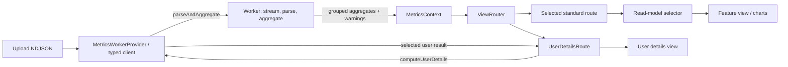

# GitHub Copilot User Level Metrics Viewer

Architecture, data ownership, and interpretation rules for the browser-only metrics viewer.
See [PRODUCT.md](../PRODUCT.md) for product direction and [README.md](../README.md) for setup and commands.

## Purpose and Supported Input

Engineering leaders and Copilot administrators upload GitHub Copilot user-level `.ndjson` exports to explore adoption and usage by user, IDE, language, feature, and model. Files stay in the browser; there is no backend.

- Each record represents one user's activity for one day. [CopilotMetrics](../src/types/metrics.ts) defines the input contract.
- Only the new LOC schema (`loc_added_sum`, `loc_deleted_sum`, `loc_suggested_*`) is supported. Records with deprecated `generated_loc_sum` / `accepted_loc_sum` fields or missing required fields are skipped.
- Broader input validation is external to the viewer. Aggregate enterprise/organization reports are not supported input.
- `public/data/vscode.json` and `public/data/jetbrains.json` provide contextual plugin metadata, not primary metrics.

## Architecture Invariants

- **Static, client-side application.** Next.js App Router, TypeScript, Tailwind CSS, Primer, and Chart.js (`react-chartjs-2`). `output: 'export'` targets GitHub Pages; no SSR or API routes.
- **Parsing and aggregation stay in a Web Worker.** The `parseAndAggregate` flow returns only compact, grouped aggregates. Raw `CopilotMetrics[]` never reaches view components or main-thread state.
- **Worker bundling is explicit.** [build-worker.mjs](../scripts/build-worker.mjs) uses esbuild to produce the self-contained `public/workers/metricsWorker.js` IIFE before `next dev` and `next build`.
- **User details are on demand.** The worker retains day-level data needed by profile charts and the day dialog, plus customization/agent and version observations, not raw records or duplicate per-user dimensional period maps. It builds period maps only for the selected profile and memoizes at most one detail response, clearing it on a new upload.
- **Each aggregate has one owner.** Metric-family accumulators own creation, record consumption, and finalization. The coordinator wires them together in one raw-record loop and assembles the grouped contract without duplicate aggregation.
- **Read models are pure projections.** Selectors preserve nested references without copying, sorting, filtering, or mutation. Deterministic feature-specific scalar/date derivations are allowed; only the selected route computes its projection.
- **Population summaries are worker-owned.** AI-credit statement totals, monthly totals, concentration, and top five users are finalized in `ai.creditsSummary`; views only format them. Release-metadata-dependent client health uses a memoized pure selector because that metadata loads on the main thread. Inactive profile routes skip population lookup/ranking, and selected-user feature totals, distributions, daily credits, CLI totals, and client table/interaction series arrive in `UserDetailedMetrics.presentationSummary`; labels and colors stay in presentation.

## Data Flow

1. `useFileUpload` checks extensions and requests parsing through the typed worker client.
2. [metricsFileParser.ts](../src/infra/metricsFileParser.ts) streams files with `File.stream()`, parses lines, interns strings, and passes each accepted record directly to aggregation without collecting an upload-wide raw array. Accepted records survive later file-read failures; consumer/aggregation failures remain fatal.
3. [metricsAggregator.ts](../src/domain/metricsAggregator.ts) exposes create/accumulate/finalize stages, coordinates the metric families, resolves shared signals, and tracks record count and the first enterprise login suffix in the same pass. CLI sessions are accumulated once and shared through a narrow read-only dependency with engagement/adoption.
4. The worker returns aggregates, enterprise name, record count, and per-file parse errors. Partial failures produce a non-fatal UI warning.
5. `MetricsWorkerProvider` owns the lazy worker lifecycle, request/progress correlation, reusable reset cancellation, and permanent disposal on unmount.
6. `ViewRouter` owns upload, fatal-error, and loading gates plus route selection. Standard adapters select narrow view models; `UserDetailsRoute` owns selection, request invalidation, stale-result rejection, retry, cleanup, and effect-only redirects. It preserves the grouped aggregate object as dataset identity.
7. `ViewErrorBoundary` contains active-view render failures without unmounting navigation, headers, or upload/reset controls. Its fallback offers retry and overview navigation, and resets when the view, selected user identity, or aggregate dataset reference changes. Processing and user-detail request errors retain their separate recovery flows.

## Code Map and Ownership

| Location | Responsibility |
|---|---|
| `src/app/` | App Router entry points and providers |
| `src/components/layout/` | App shell, navigation, router, and typed standard-route registry |
| `src/components/features/` | Feature presentation, sections, feature-only charts, and focused tests |
| `src/components/ui/`, `src/components/charts/` | Shared primitives, Chart.js visualizations, and chart utilities |
| `src/state/`, `src/components/MetricsContext.tsx` | Navigation, worker access/lifecycle, aggregate/loading/error/warning state |
| `src/hooks/` | Upload and reusable interaction hooks |
| `src/read-models/` | Pure feature projections |
| `src/workers/` | Framework-free worker entry point, typed client, and message contracts |
| `src/infra/` | Streaming parser |
| `src/domain/aggregation/`, `src/domain/calculators/` | Metric-family lifecycles and pure calculations |
| `src/domain/modelConfig.ts` | Curated model catalog (canonical display names, categories, vendors), normalization, aliases, and unknown/empty detection |
| `src/types/`, `src/utils/` | Contracts and shared utilities |

The [AggregatedMetrics contract](../src/types/aggregatedMetrics.ts) groups fields by owning slice:

| Slice | Owns |
|---|---|
| `overview` | Core stats, engagement, chat usage, executive summary |
| `users` | User summaries |
| `adoption` | Feature adoption and VS Code Agents window usage |
| `impact` | Agent, completion, edit, inline, ask, CLI, and joined impact |
| `languages` | Language stats, feature impact, generation and LOC series |
| `clients` | IDE stats/counts, plugin versions, telemetry warnings |
| `models` | Daily model usage and model breakdown |
| `cli` | Session, token, and adoption series |
| `copilotApp` | Copilot App session, token, and adoption series |
| `ai` | Adoption phases, usage distribution, and credits |
| `productivity` | Surface reach, active user-days, attributed LOC, and overlap cohorts |

Executive Summary composes `overview` and `adoption`. Shared charts stay outside feature folders when multiple features consume them.

Overview preserves its billing/activity header and presents two compact reach lenses with drill-throughs to Clients and Copilot Adoption. Worker-owned `overview.clientReachData` ranks distinct users per reported client from finalized `clients_used` summaries, combining active historical IDE rows, CLI/App usage signals, and positive client traffic without adding their counters. Client IDs stay distinct; aliases only affect display labels. The client preview shows the top six rows, not an additive total. The workflow preview reuses feature adoption counts for completions, editor Agent Mode, Ask, Plan, code review, and coding agent; CLI/App reach remains on the client side and other workflows remain available in Adoption. Both lenses use distinct users in uploaded records as their reach denominator, not licensed seats or the narrower feature-adoption population. Missing client traffic is explicitly unavailable, and its reported-record coverage does not imply complete IDE/workflow telemetry. The former standalone engagement and Chat charts are no longer shown on Overview; their underlying aggregates remain unchanged.

The **Copilot working patterns** reach profile sits between billing and the two lenses. The engagement/adoption worker lifecycle owns `overview.workingPatterns`, retaining only per-user positive-evidence flags and a four-surface set. Assistance counts completions and non-Agent Ask/Inline/Edit/Plan activity, not generic Chat flags or root generations. Local agents count editor Agent Mode, CLI, App, and the VS Code Agents window from explicit flags, positive dedicated totals/features, or recognized positive client traffic. Delegated workflows count the existing cloud-agent resolver, active/passive code-review flags, and positive `cloud_agent`, `code_review`, or `agentic_workflows` client traffic. These groups overlap; no stage, score, or exclusive cohort is assigned. Two-or-more local surfaces deduplicates the four surface types across days, not IDEs, models, agents, or concurrent sessions. Local + delegated is the same-user intersection anywhere in the window. Unknown clients and zero-only rows do not establish a pattern. The snapshot spans the union of uploaded report windows and observed dates; percentages use all distinct uploaded users. Optional record-level source availability is disclosed separately and is not completeness. Parser provenance preserves availability before optional flags are defaulted, and distinguishes App presence from positive activity. Delegated reach and its intersection stay null when neither relevant flags nor client traffic are reported; reported zero remains zero. Users without positive pattern evidence are disclosed without calling them inactive. The profile measures observed breadth, not orchestration or causal productivity.

Copilot App Adoption replaces the former CLI Adoption page, retaining the adoption trend, daily users, sessions, tokens, and model usage charts. Its worker-owned series use `totals_by_copilot_app` and App usage signals; its model breakdown uses only `copilot_app` feature interactions. CLI aggregates remain separate for other views. The internal `cliAdoption` navigation key is retained for compatibility. Daily model charts use canonical catalog display names, falling back to the reported identifier for uncatalogued models.

Copilot Impact and user-details views omit a standalone Edit Mode Impact chart. Edit Mode data remains included in combined impact totals.

## Metric Interpretation

These contracts prevent plausible-looking but misleading analysis. Detailed calculations and edge cases belong with the linked implementations and tests.

- **Profile calendar activity includes client traffic without mixing counts.** The worker retains the legacy logarithmic intensity score (root interactions + generations + acceptances + CLI prompts), relative to the user's busiest legacy day. Any client with positive requests, sessions, or tokens makes a traffic-only date level 1; overlapping traffic does not inflate legacy shading. Zero-only, missing, and null client records do not establish activity. The calendar header counts distinct dates with a positive level, independently of the user summary's uploaded-date `days_active`. See [calculator](../src/domain/calculators/activityCalendarCalculator.ts).
- **Missing is not zero.** Optional VS Code Agents window flags/counts retain null or absence; only reported values contribute to totals, with field-level coverage against uploaded user-day records. Active users use explicit flags and deduplicated user IDs; sessions/messages are independent totals. See [calculator](../src/domain/calculators/vscodeAgentUsageCalculator.ts).
- **Telemetry/version-gap input signals are independent.** The worker parser accepts optional `client_telemetry_present` (`boolean | null`) and `usage_metrics_requirements` (`{ met: string[]; unmet: string[]; unknown: string[] } | null`). Older exports can omit either field; absence, null, explicit false, and reported empty lists are preserved without defaults. A present requirements object must supply all three string arrays; invalid shapes skip the record with a field-specific warning. Raw identifiers, including unfamiliar values such as `1.138.0:`, retain their spelling, order, and duplicates without a closed catalog. Omitted/null means unavailable, not false or zero. Telemetry true does not prove completeness; false does not mean inactivity or diagnose a cause. See the [announcement](https://github.blog/changelog/2026-11-05-usage-metrics-api-flags-telemetry-and-version-gaps/) and [API reference](https://docs.github.com/en/enterprise-cloud@latest/copilot/reference/copilot-usage-metrics/copilot-usage-metrics).
- **Fleet Health separates reported evidence from version guidance.** The worker computes `clients.reportingQuality`; the Client Versions read model projects it without raw-data computation. Summary cards count distinct user IDs affected anywhere in the uploaded period, independently for explicit false telemetry and nonempty unmet requirements. Daily counts and per-component unmet/unknown counts each deduplicate user IDs; overlapping categories, components, and daily counts must not be added to derive period uniques. Unknown is unverifiable, not below minimum; missing/null requirements do not create unknown failures. The daily trend spans the union of uploaded report windows and observed dates, with signal-specific gaps on unreported days and zeros only when a signal is reported. Separate telemetry and requirements coverage counts use uploaded records, not licensed seats. IDE and extension identifiers stay separate in the sortable requirements table. All Fleet Health tables use independent 10-row pagination without render-all controls. Pages reset when their data or sorting changes; affected users also reset on filter changes and support Missing telemetry / Below minimum / Either filters. The affected-users table links to existing profiles and records distinct issue dates, unmet components, and latest observations per issue. Missing telemetry is user-level, never assigned to an IDE. These historical observations do not prove current faults. The release-metadata dashboard remains a separate comparison, not API minimum-requirement evidence. October inference appears only as collapsed, explicitly historical guidance when neither new signal is reported; other views retain their existing warnings. Global Users filters remain outside this slice. See [calculator](../src/domain/calculators/reportingQualityCalculator.ts) and [view](../src/components/features/client-versions/FleetHealthView.tsx).
- **Profile reporting quality is calendar/day-local evidence.** The worker retains detached optional telemetry/requirements fields in compact `UserDayData` and computes `UserDetailedMetrics.reportingQuality`; read-model selectors only project selected dates. Calendar server icons mark explicit false observations without changing activity shading, intensity, or active-day counts. The legend counts distinct server-side-only dates and signal coverage over uploaded/observed user dates, not the full displayed calendar range. Duplicate dates count once; any false observation marks that date missing even if another record reports true. Requirements are independently deduplicated by exact component and reported status, without merging IDE and extension identities. Hover/focus cards show the date, telemetry availability, independent below-minimum/unknown counts, at most three affected component observations, and an overflow count; clicking, keyboard activation, and tapping still open day details. Received telemetry is not proof of completeness, and missing telemetry does not establish a cause. The Daily Modal shows only the selected day's Received / Missing / Not reported telemetry and Meets minimum / Below minimum / Unknown component observations. Null/omitted requirements are unavailable; reported empty arrays mean no listed components, not all passed. No October inference or period totals enter this presentation. Date navigation updates the evidence, and switching users closes/reset the day modal and calendar preview. No separate profile reporting-quality section is added.
- **Local BYOK is an optional feature flag.** Per-day data preserves missing, null, and explicit false values; user summaries OR only reported flags across days. Profile/day labels and the Users table filter indicate usage only for explicit `true`.
- **Profiles do not infer upgrades from historical IDE versions.** The profile notice, per-user October-risk accumulator, warning read-model fields, and compact-day IDE-version tracking are removed. Raw IDE versions remain accepted for aggregate client guidance; ordinary profile plugin/CLI version tables remain intact. Profile reporting-quality indicators use the independent API telemetry and requirement signals, not version-policy inference. Existing Client Analysis warnings and Fleet Health's disclosed historical fallback are unchanged.
- **Requirement labels retain raw identities.** The requirements table and affected-users unmet-component column share canonical IDE names and framed icons for recognized component prefixes, with the raw identifier underneath. Extension suffixes remain separate; unfamiliar identifiers are displayed unchanged without a guessed icon. Display aliases do not merge rows, counts, or sort keys. Both tables match the Users table's frame and small body typography. Affected-user issue types use Primer status pills.
- **Client model traffic is separate.** Optional `totals_by_client` preserves absence/null versus an empty array, raw client/model identifiers, and future selection modes. Requests are model calls, not prompts; zero reported sessions do not imply no traffic. The parser validates counts and token averages and interns identifiers. Worker results expose period/daily traffic with reported-record coverage, request-active users deduplicated by ID, reported session sums, and model/selection-mode breakdowns. Token averages are recomputed from summed tokens/requests (null with no requests). User details retain traffic and compute the same summaries on demand. Client Analysis shows a separate sortable traffic table, coverage counts/observed dates, and distinct unavailable versus reported-empty states. Its traffic, client-user, and engagement tables use independent 10-row pagination, resetting on sorting or data changes, with the same controls as Fleet Health. Traffic never enters legacy IDE, CLI, App, interaction, or LOC totals or feature flags. The worker adds clients with positive requests, sessions, or tokens to each user's `clients_used` set alongside historical clients; zero-only entries do not imply usage. OpenCode, Claude Code, and Codex use MIT-licensed vendor SVGs; Slack uses a CC0 vendor SVG. GitHub Desktop/Mobile use Primer device icons and Web uses the GitHub mark; App/SDK/Cloud Agent use Copilot icons, Agentic Workflows uses workflow-16, and Code Review uses code-review-16. Client identities remain distinct. See [icon attribution](icon-attribution.md) and [calculator](../src/domain/calculators/clientTrafficCalculator.ts).
- **Primary client preserves legacy precedence.** The worker selects the existing interaction-based primary client first (including CLI prompt/usage fallback). Only when none is detected does it use the largest summed positive `totals_by_client[].request_count`, merging trimmed client IDs and breaking ties lexically. Session/token-only traffic does not establish a primary client. The profile header and Users table consume the same `top_client` value; request counts never mix with legacy interactions.
- **Agent surfaces are distinct.** The VS Code Agents window is separate from editor Agent Mode. Profile agent activity uses dedicated CLI/App/VS Code Agents window totals, not feature interactions; sessions are not deduplicated across surfaces and prompts/messages may use different definitions. Unreported counts stay null, explicit zeros stay visible, and token data remains separate. VS Code Agents window metrics do not enter generic client, interaction, LOC, or Agent Mode rollups. See [agent activity calculator](../src/domain/calculators/agentActivityCalculator.ts).
- **Adoption phase labels are display-only.** Phase 0 is displayed as Chat-first users; the API's `No Cohort` value and phase number are unchanged. These active users did not meet any phase's engagement criteria (qualifying feature usage on at least two days in the 28-day period), and did not necessarily use only chat. Feature usage counts in this app reflect observed usage, not that engagement threshold.
- **Third-party agents stay separate.** The worker aggregates `totals_by_3rd_party_agent` interactions by agent ID and day for each user. Profiles with reported entries show a daily chart below agent-native activity, covering the full report range; these counts do not enter Copilot interaction or LOC totals.
- **Customizations have independent coverage.** Profile totals sum reported daily `distinct_*_use_count` values, not period-wide uniques or item-list counts. Missing/null fields are unavailable; empty lists and explicit zero counts are reported zeros. Item lists are per-record top-five observations; hidden `other`/`custom` names are not reconstructed. `interaction_count`, including zero, takes precedence over `user_initiated_interaction_count`; supplied counts must be nonnegative safe integers. Names without counts remain valid, but affected item/category interaction totals, invoked days, and averages are unavailable. Invoked days are distinct dates with positive counts; zero-only averages are undefined. MCP events mean connection attempts, not tool calls. Day details use that day's counts, independently of CLI sessions. See [calculator and contracts](../src/domain/calculators/cliCustomizationCalculator.ts) and [tests](../src/domain/calculators/__tests__/cliCustomizationCalculator.test.ts).
- **Language normalization is uploaded-period activity.** Observed users are distinct IDs with language-feature entries, including zero activity, and may overlap across languages. Generation share includes all language rows, including unknown and rows on other pages; zero denominators are undefined. Sorting uses unrounded values. These are not weekly rates or productivity rankings. See [aggregation](../src/domain/aggregation/languageAggregation.ts) and [tests](../src/domain/aggregation/__tests__/languageAggregation.test.ts).
- **Telemetry warnings describe observations, not proven faults.** The [October 6, 2026 announcement](https://github.blog/changelog/2026-10-06-update-your-ide-to-restore-agent-activity-in-copilot-usage-metrics/) supplies IDE baselines, not plugin baselines or affected lower bounds. Pending fixes and unknown/unparseable versions prompt verification. Historical observations remain flagged after upgrades; missing activity cannot be backfilled. Billing is unaffected and CLI-only users are excluded. The worker deduplicates users per observed version, including zero-activity server-side IDE rows; client-filtered notices use that client's warnings. See [calculator](../src/domain/calculators/clientTelemetryCalculator.ts) and [tests](../src/domain/calculators/__tests__/clientTelemetryCalculator.test.ts).
- **Leadership Brief denominators are observational.** The worker computes it from finalized user summaries and daily engagement. Its window spans observed dates, not first-file report metadata; gaps are unreported, and weekday means use only recorded dates. Feature reach uses observed users and permits overlap. AI credits retain existing missing-to-zero normalization and signed totals; negative user totals or nonpositive overall totals suppress concentration shares. Root LOC totals stay signed. Upload warnings remain report limitations even when the application banner is dismissed, and clear on reset/new upload. The print-stable brief has no expandable content and excludes controls/chrome. It does not measure license utilization, shipped code, financial ROI, or causal productivity. See [calculator](../src/domain/calculators/executiveSummaryCalculator.ts), [tests](../src/domain/calculators/__tests__/executiveSummaryCalculator.test.ts), and [view](../src/components/ExecutiveSummaryView.tsx).
- **Unavailable sections stay absent.** User profiles/day details omit unreported customizations, wholly unavailable VS Code Agents window sections, and empty feature/client/language/model breakdowns. Explicit zeros remain visible; navigation links only to rendered sections.
- **Activity by Client keeps measures separate.** User profiles use one section with an Interactions / Reported sessions / Model requests selector (traffic measures only when traffic is reported). The default is the first measure with positive counts, in that priority order; all-zero data falls back to interactions, and users can switch measures manually. Model requests are model calls, not user interactions or prompts. Daily grouped traffic bars span the full report range: reported zeros remain visible, missing days use null, and legacy interactions never backfill traffic. The summary table joins client IDs across legacy activity and server traffic, treating `github_app` and legacy `copilot_app` as one Copilot App row without changing raw metric identities. Traffic-only clients are included; unavailable metrics say "Not reported". It displays all available metric columns and paginates ten clients per page. Coverage describes uploaded user-day records; session totals cover only reported records, are not deduplicated across clients/days, and are not added to legacy CLI/App counts.
- **Summary measures are independently selectable.** Client and Models tiles each offer Interactions / Model requests. Each defaults to interactions when positive legacy/assumed values exist (including CLI prompts for clients), otherwise to requests when positive request counts exist; all-empty data defaults to interactions. Manual choices persist for the current user and reset when switching users. Selected measures with no positive values show the existing empty state. Client requests come from `totals_by_client[].request_count`; model requests come from `totals_by_client.totals_by_model`, summed across clients and selection modes. Compact selectors share a header row with stable Clients / Models titles; Languages shows its fixed Generations measure in the same row. Accessible selector labels are visually hidden, and print retains the selected measure as text. Charts use the selected measure's units; requests never mix with interactions.
- **Day breakdowns have independent measures.** The modal's client and model tables offer Legacy activity / Model requests, defaulting to positive legacy activity first, otherwise positive day-local requests from `totals_by_client`. Client legacy detection uses recorded/assumed interactions and CLI prompts; the existing language/model table uses its generation, acceptance, and LOC counters. Request tables retain client/model selection-mode and token detail without inventing language or feature attribution. The client doughnut follows the client selector and includes request-only activity. Missing selected measures show an explicit empty state; reported zeros remain visible. Manual choices reset on date/user changes and reopening, and arrow keys within selectors do not navigate dates.

- **Model types by selection mode use requests.** Model Details shows three side-by-side doughnuts for `user_selected`, `auto`, and `product_selected`, grouped by the existing model catalog categories and summed across clients/days in the worker. Unknown models from the `code_review` client appear as Code Review Model; other unknown or unmapped models remain Uncategorized. Each chart's shares use only that mode's model requests, never legacy interactions or client-level totals. Other, unknown, and future selection modes are excluded with a visible request count; coverage distinguishes unreported traffic from reported empty traffic.
- **Model vendor filtering uses Primer's single-select menu.** Models Daily Usage lists only reported vendors, with shared vendor icons in the options and selected button. All Vendors restores the full series; selections clear when their vendor disappears from refreshed data. Auto, CLI, and App model charts remain unfiltered.
- **Custom model providers are report labels, not inferred vendors.** The worker groups positive model-feature interactions by the raw prefix before `/` and retains the remaining model spelling; HTTP(S) labels use their origin as the provider and remaining path as the model. Counts match existing model tables, including assumed code-completion interactions, and never mix in client requests or language-model rows. Provider and model users are independently deduplicated across dates/features. Labels do not prove BYOK usage or underlying vendor identity; standard and unprefixed labels remain outside this table. Directly above Local BYOK, Model Details uses category-style provider disclosures with model counts, interactions, report-wide interaction shares, and distinct users. Provider/model lists have independent 10-row pagination. Known model names, including hyphenated version spellings, reuse catalog vendor icons; unknown names keep the generic icon and provider headings remain neutral. These display-only matches do not change existing model/vendor classifications.

## UI Conventions and Enforced Boundaries

### UI foundation

- Long tables use pagination, not show-all row expansion. `MetricsTable.pageSize` owns independent paging and resets on data/order or page-size changes. Language tables and profile clients use 10 rows; version history, customization items, and day clients use 5; day model tables use 10. Category/group disclosures and metric-detail column toggles are retained.
- `TableCard` owns the bordered white surface, title/description, optional compact `headerActions`, full-width `toolbar`, and `footer` slots. Search/filter controls and filtered counts stay caller-owned in the toolbar; callers with external paging compose `TablePagination` in the footer. Explorer retains 20-row pages and inline details; Users uses 200-row pages and retains profile navigation. Both show the range for single-page results, hide navigation when unnecessary, and replace empty tables with their contextual empty state.
- Primer `ThemeProvider` uses `colorMode="day"` for deterministic static export; `BaseStyles`, light-theme primitives, and Tailwind share Primer's system font stack.
- Use Primer semantic utilities (`text-default`, `text-muted`, `bg-muted`, `border-default`, etc.), not neutral hex/`gray-*` colors. Unmapped utilities such as rings/outlines use `var(--token)` arbitrary values. Canonical client chart colors and language brand colors are explicit exceptions.
- Prefer Primer components and token-based CSS Modules; Tailwind handles layout, spacing, and print variants. Unlayered Primer/CSS Module styles outrank Tailwind layers, so style Primer through props, wrappers, or CSS Modules. `BaseStyles` owns default text/font/link styling; use Primer `Link` for links.
- `globals.css` imports only `@primer/tailwind-config/color`, mapping semantic utilities and disabling Tailwind's default palette without resetting spacing, typography, or other theme settings. ESLint runs the Primer plugin and rejects palette/arbitrary-hex classes in production `src/app` and `src/components` strings.
- Responsive prefixes use Primer breakpoints configured in `globals.css`, not Tailwind defaults. Form controls, navigation, dialogs, feedback, and labels use Primer; semantic metadata stores roles/variants, not Tailwind class strings.
- The users table uses its available container width, not the viewport: Days Active, Cloud Agent, and Code Review are hidden below 100rem (1600px); Features Used is hidden below 80rem (1280px). This accounts for space occupied by the app sidebars.
- Users table "Clients used" and feature filters use searchable Primer multi-select panels, with icons for client options. Client options combine historical and server-traffic usage and deduplicate canonical aliases. Labels sort alphabetically with letter-prefixed names first, digit-prefixed names next, and other prefixes last; embedded numbers sort naturally. The filter groups `github_app` and legacy `copilot_app` into one Copilot App option matching either source; raw metrics identities remain unchanged. Other distinct clients that share icons stay separate. Users match any selection within a group and every active group, together with the username search; an empty selection leaves that group unrestricted. Anchors show at most two selected labels followed by `...`, with the full selection available in the accessible name and tooltip.
- Chart.js canvas styling reads Primer tokens through [chartTheme.ts](../src/components/charts/utils/chartTheme.ts), with static light fallbacks for prerender/tests. Composition charts limit slices to the top four plus expandable Other and expose values/shares in an HTML legend; overlapping client populations must not imply a unique-user sum. Circular/radar charts are exceptions to the preferred bar/line/area charts.
- Client charts resolve the approved palette from [ideMetadata.ts](../src/utils/ideMetadata.ts) through `getIdeColor`, consistently across organization, profile, day, interactions, and sessions views. All known clients have fixed colors, aliases match, and unknown clients use neutral gray rather than rank-based fallbacks. `github_app` and `copilot_app` share a color but remain separate metric identities. Original names and icon colors are unchanged. Client bar comparisons expose an opt-in "Show client patterns" control, with matching chart/legend textures and keyboard-operable bar-series visibility buttons. Six stable, repeating motifs are supplementary cues, not unique identifiers; names and numeric breakdowns remain necessary. Doughnuts use solid colors and client icons without pattern controls.
- All standalone doughnuts use `CompositionChartCard`, which combines the shared `ChartContainer` surface and `CompositionChart` renderer. Card headings, spacing, header controls, and empty states are consistent; data-source selectors remain available when the selected data is empty. Callers own data preparation, selector state, units, and whether overlapping entries hide the center total.
- User Summary keeps all three distribution tiles visible. Missing distributions or distributions without positive finite values show the shared empty state instead of a doughnut.
- User Summary and the day dialog share the inline `FeaturesUsed` label-and-pills row; each caller supplies its own feature labels and usage detection.
- Experimental Primer components are imported only through local `EmptyState` and `SkeletonText` wrappers.
- DOM tests opt into jsdom; `@primer/*` is inlined and shared setup supplies polyfills. Stub `matchMedia` where needed. Assert semantic roles/text/attributes rather than hashed CSS classes; Banner renders actions in both responsive layouts.

### Dependency boundaries

[ESLint restrictions](../eslint.config.mjs) enforce:

- UI, layout routes, and read models cannot import aggregation implementations.
- Production domain and worker modules cannot import React, Next.js, components, or state contexts.
- Shared UI and charts cannot import feature modules or layout routes.

Read models depend on the grouped contract and pure domain helpers; workers depend on the parser, domain aggregation, and message contracts. Tests may import lower-level helpers for fixtures and characterization.

### Advisory UI review workflow

`ui-consistency-review` reviews net changes to production `src/app` and `src/components` UI and direct UI dependencies. Tests, fixtures, generated files, pure moves, and unrelated source/dependency changes do not independently trigger review; manual historical reviews use the same relevance gate. Preparation supplies the complete file inventory without unrelated patches, plus merge-base/head-pinned UI patches and dependency deltas. Binary UI assets require visual review; missing/truncated patches, revision races, or limits (30 UI files, 20 KB per patch, 120 KB packet) fail explicitly rather than produce a partial clean review.

The agent reads unchanged code only to resolve a changed-line candidate and reports at most three actionable findings in a 250-word advisory comment. Inventory and coverage stay in workflow summaries/logs. A no-findings run replaces previous advice with one sentence. File-content reads explicitly accept untrusted PR revisions, scoped to this repository; same-repository checks, read-only permissions, non-execution rules, threat detection, and head/base publication guards remain in place.

When an open PR loses UI relevance, a deterministic, freshness-guarded job replaces existing workflow-bot advice without invoking an agent or creating a new comment. Binary renames are considered pure moves only after verifying equal merge-base/head blob SHAs. Test-only React tooling upgrades do not independently trigger a review.

Preparation runs only for same-repository PRs (or manual dispatch) and loads its automation helper at the immutable workflow-source SHA, so workflow/helper changes work before merge. Review policies still come from the default branch; reviewed application code is never executed.

Validate preparation and workflow wiring with `node --test scripts/tests/prepare-ui-review.mjs .github/workflows/__tests__/ui-consistency-review.node.mjs`; regenerate the lock with `gh aw compile ui-consistency-review --validate`, preserving `.gitattributes`' `merge=ours` rule.
